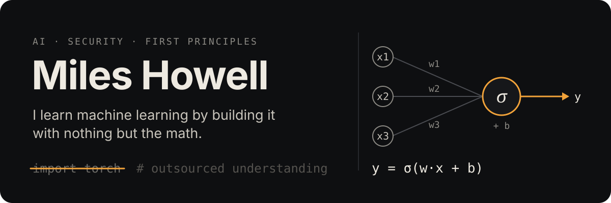
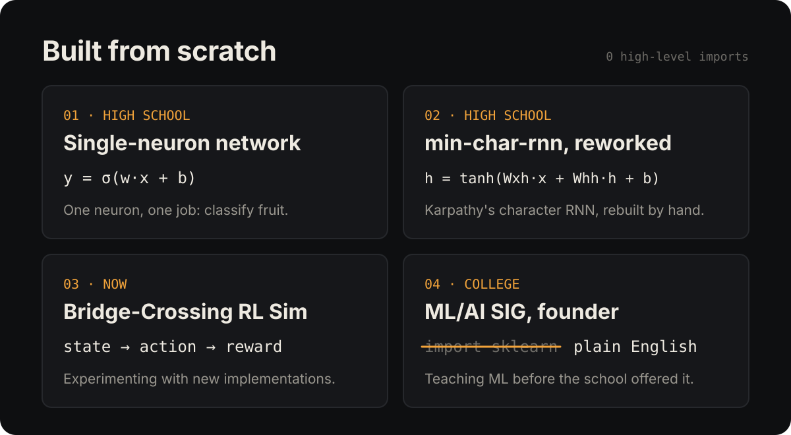

  

I enjoy working on low-level problems, mainly in **AI** and **cybersecurity**. I'd rather understand a model from its equations than call it from a library.

  

- **[Single-neuron network](https://github.com/mileshowell/Artificial-Intelligence/blob/master/fruit_classifier.py)**: a fruit classifier, written in high school while OpenAI was still focused on Gym.
- **[min-char-rnn, reworked](https://github.com/mileshowell/Artificial-Intelligence/blob/master/rnn.py)**: my rework of Karpathy's famous character-level RNN, built to show off to classmates.
- **[Bridge-Crossing RL Sim](https://github.com/miles-howell/Bridge-Crossing-RL-Sim)**: where I'm currently experimenting with new implementations.
- **ML/AI Special Interest Group**: a college group I started and led (more below).

## Background

In high school, I co-led the programming club and consulted on the state's first high school cybersecurity curriculum.

In college, I spent two years doing coursework in Computer Science and Mathematics, and started the **ML/AI SIG**, an optional extracurricular open to anyone at the school. At the time there were no undergraduate ML/AI courses and only a handful of graduate-level ones. In the sessions, I broke down complex topics in ML using plain English and no high-level libraries.

The goal wasn't to build a product or tool. It was to understand the technology at its core.

> High-level libraries outsource your understanding!

Things have obviously changed in AI development, and writing a production codebase of any kind with no libraries would be insanity. But that time was invaluable: it's why I fully understand the concepts behind machine learning.

## Where my head is now

I'm interested in the frontier of AI research and in experimenting with new implementations. I've gotten incredibly bored with the big AI ~~labs~~ companies and their current pace of research. If not the pace, then the style and focus of their work. I miss the days when anything was possible with AI!! Now, we only call it a "breakthrough" if it means my AI waifu uses fewer tokens to tell me she loves me.

*Really* though, I'm just exhausted by LLMs and the news cycles. There are much *MUCH* more interesting (and world-altering) ways to use this technology. We'd only just started to scratch the surface when ChatGPT and its counterparts appeared and forever changed the landscape of ML research, skewing everyone's perspective towards one narrow use of a technology that's existed for nearly a century!

## Say hi

Email me at **[miles@plannedpixel.com](mailto:miles@plannedpixel.com)** to chat or discuss my work.
